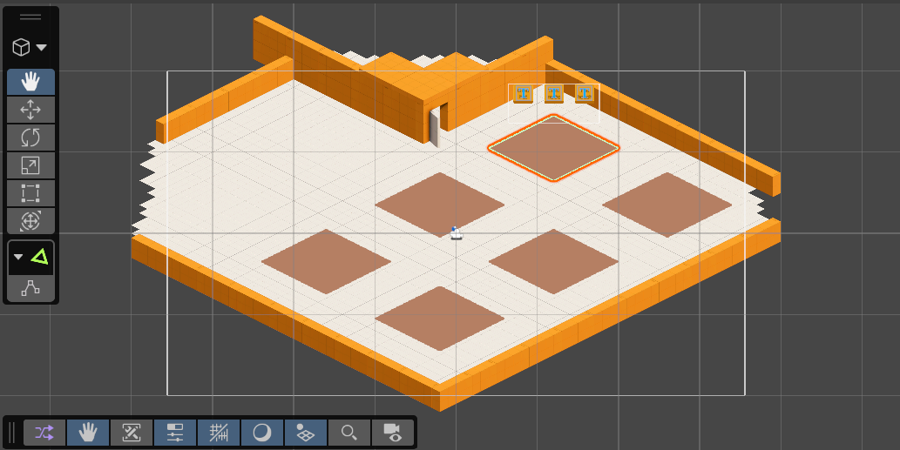
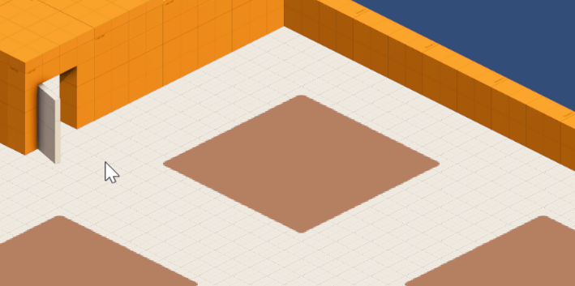
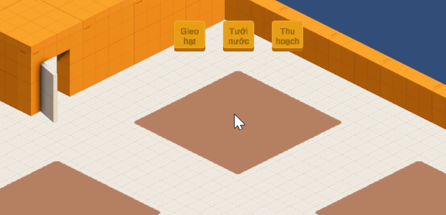
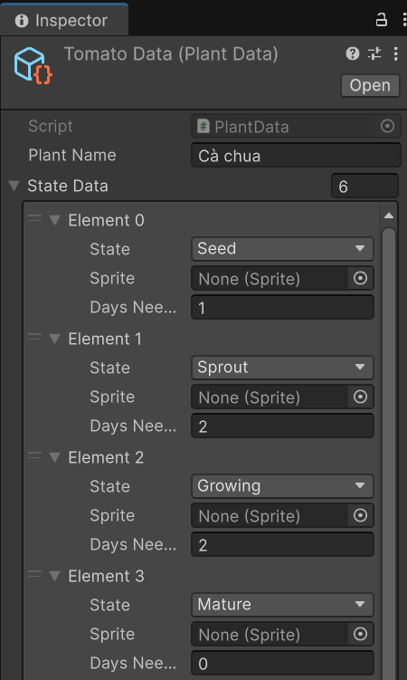
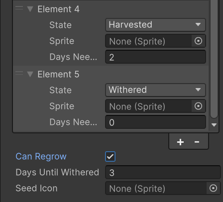

# BÁO CÁO TIẾN ĐỘ TUẦN 1
**Học phần:** Project 1  
**Giảng viên hướng dẫn:** ThS./TS. Nguyễn Hoàng Long  
**Sinh viên thực hiện:** Lê Mạnh Trường  
**Mã số sinh viên:** 202416375   

---

## 1. Tên đề tài
* Xây dựng game 2D mô phỏng trồng cây và nấu ăn: **Rooftop Garden (Vườn thượng)** trên nền tảng Unity Engine.

---

## 2. Mục tiêu của tuần
* Thiết lập môi trường phát triển và cấu trúc khung cảnh màn chơi 2D Isometric cho khu vực sân thượng (Rooftop).
* Xây dựng hệ thống giao diện tương tác gắn liền không gian thế giới ảo (**World Space UI**) gắn với từng ô đất (`Plot`).
* Thiết kế kiến trúc dữ liệu cây trồng hướng dữ liệu (**Data-driven architecture**) sử dụng `ScriptableObject` (`PlantData`) nhằm phục vụ việc mở rộng hệ thống cây trồng và nông sản linh hoạt.
* Hoàn thiện cơ chế nhận diện đầu vào từ con trỏ chuột cho cả thực thể 2D trong Scene và các thành phần giao diện người dùng (UI).

---

## 3. Nội dung thực hiện
1. **Dựng môi trường (Level Design):**
   * Tìm hiểu và ứng dụng cơ chế lưới **Isometric Tilemap** trong Unity 2D.
   * Nhập (import) và chuẩn hóa gói tài nguyên đồ họa (assets) dạng 2D Hand-painted / Isometric tileset.
   * Thiết lập hệ thống mặt bằng (sàn gạch sân thượng), các mảng tường bao, lan can và xác định các vị trí bố trí ô đất canh tác.
2. **Thiết kế giao diện (UI & UX cơ bản):**
   * Triển khai `Canvas` ở chế độ **World Space** thu nhỏ trực tiếp tại từng ô đất.
   * Tạo bảng điều khiển menu thao tác (`MenuContainer`) gồm 3 nút chức năng cơ bản: *Trồng cây (Gieo hạt), Tưới nước, Thu hoạch*.
3. **Xử lý tương tác & cơ chế dò tia (Input & Raycasting):**
   * Phối hợp `PolygonCollider2D` và `Physics2DRaycaster` trên Camera để bắt sự kiện di chuột (`PointerEnter`, `PointerExit`) trên ô đất 2D.
   * Tích hợp `Graphic Raycaster` trên World Space Canvas để xử lý sự kiện tương tác trên các thành phần UI.
   * Ứng dụng `Coroutine` quản lý độ trễ hiển thị (`hideDelay`), loại bỏ hiện tượng giật menu khi người chơi di chuyển chuột qua lại giữa ô đất và bảng điều khiển.
4. **Thiết kế kiến trúc dữ liệu cây trồng:**
   * Xây dựng lớp dữ liệu `PlantData` kế thừa từ `ScriptableObject`.
   * Thiết lập cấu trúc `PlantStateData` định nghĩa chi tiết hình ảnh biểu diễn (`Sprite`) và số ngày sinh trưởng cần thiết (`daysNeeded`) cho từng giai đoạn sinh trưởng của cây.

---

## 4. Kết quả đạt được

### 4.1. Môi trường 2D Isometric
* Xây dựng hoàn chỉnh bản đồ sân thượng góc nhìn Isometric cơ bản: phân tách rõ ràng các tầng lớp hiển thị (Floor, Wall, Slabs, Plots).
* Tích hợp cấu hình chuẩn xác hệ tọa độ trục chiếu giúp các ô đất và nhân vật/vật thể sau này không bị lệch thứ tự phối cảnh chiều sâu.

### 4.2. Hệ thống ô đất & Menu thao tác (World Space UI)
* Mỗi ô đất (`Plot`) được đóng gói thành một thực thể độc lập quản lý:
  * Điểm định vị gieo mầm cây (`plantSpawnPoint`).
  * Canvas tương tác cục bộ (`actionMenuCanvas`) hiển thị bảng điều khiển (`MenuContainer`).
  * Bảng điều khiển tích hợp sẵn các nút thao tác nhanh: **Trồng cây**, **Tưới nước**, **Thu hoạch**.
* Cơ chế tự động ẩn bảng điều khiển ở trạng thái chờ và chỉ kích hoạt khi con trỏ chuột di vào vùng tương tác của ô đất hoặc đang tương tác trên bảng menu.

### 4.3. Xử lý triệt để xung đột trạng thái (Race Condition) khi di chuột
* Ban đầu, việc chuyển đổi chuột giữa bề mặt ô đất và các nút bấm UI gây ra hiện tượng xung đột Coroutine (nhiều Coroutine kiểm tra ẩn menu chạy song song), khiến menu biến mất đột ngột dù chuột đã vào menu.
* Hệ thống đã được nâng cấp cơ chế quản lý vòng đời Coroutine tập trung: luôn gọi hàm `StopHideCoroutine()` trước khi khởi chạy Coroutine mới hoặc khi con trỏ vừa chạm vào ô đất / menu.

### 4.4. Cấu trúc dữ liệu cây trồng Data-Driven (`PlantData`)
* Xây dựng thành công `PlantData.cs` dựa trên `ScriptableObject` cho phép thiết lập và cấu hình thông số của cây trồng trực tiếp trên Unity Inspector mà không cần sửa mã nguồn:
  * `plantName`: Tên loại cây trồng (ví dụ: "Cà chua").
  * `seedIcon`: Biểu tượng gói hạt giống phục vụ hiển thị trên kho đồ và menu chọn hạt giống.
  * `canRegrow`: Cờ xác định cây thu hoạch một lần hay có khả năng tái sinh trưởng (như cà chua).
  * `daysUntilWithered`: Giới hạn số ngày không được tưới nước trước khi cây bị héo úa.
  * `stateData`: Mảng các struct `PlantStateData` định nghĩa cho 6 trạng thái trong vòng đời cây (`Seed`, `Sprout`, `Growing`, `Mature`, `Harvested`, `Withered`).
* Cung cấp các phương thức truy xuất nhanh: `GetSpriteforState(PlantState target)` và `GetDaysNeeded(PlantState target)`.
* Đã khởi tạo thành công file tài nguyên mẫu: `TomatoData.asset` cho cây Cà chua.

```csharp
// Trích đoạn cấu trúc dữ liệu trong PlantData.cs
[Serializable]
public struct PlantStateData {
    public PlantState state;
    public Sprite sprite;
    public int daysNeeded;
}

[CreateAssetMenu(fileName = "NewPlantData", menuName = "Game Data/Plant Data")]
public class PlantData : ScriptableObject
{
    public string plantName;
    public PlantStateData[] stateData;
    public bool canRegrow;
    public int daysUntilWithered;
    public Sprite seedIcon;

    public Sprite GetSpriteforState(PlantState target)
    {
        foreach (var item in stateData) {
            if (item.state == target) return item.sprite;
        }
        return null;
    }

    public int GetDaysNeeded(PlantState target) {
        foreach (var item in stateData)
        {
            if (item.state == target) return item.daysNeeded;
        }
        return -1;
    }
}
```

---

## 5. Minh chứng kết quả

Dưới đây là các hình ảnh minh chứng ghi nhận trực tiếp từ môi trường phát triển dự án (được lưu trữ tại thư mục `/Docs/Week 1/Picture`):

### Hình 1 – Toàn cảnh môi trường sân thượng (Scene View)
*Bố cục không gian sân thượng theo dạng lưới Isometric Tilemap, thể hiện phân tầng nền sàn gạch, tường rào và vị trí phân bổ các ô đất canh tác.*



---

### Hình 2 – Trạng thái ô đất mặc định (Game View)
*Góc nhìn từ màn hình Game View khi người chơi chưa tương tác; các ô đất ở trạng thái tĩnh, bảng điều khiển menu hoàn toàn ẩn để giữ tầm nhìn thoáng đãng.*



---

### Hình 3 – Tương tác hiển thị Menu thao tác
*Minh chứng hoạt động của hệ thống nhận diện con trỏ: Khi chuột di vào ô đất hoặc di chuyển lên bảng menu, Canvas hiển thị rõ ràng 3 nút thao tác (Gieo hạt, Tưới nước, Thu hoạch).*

| Con trỏ di vào bề mặt ô đất | Con trỏ di chuyển lên Menu thao tác |
| :---: | :---: |
|  |  |

---

### Hình 4 – Cấu trúc dữ liệu cây trồng (`TomatoData`)
*Minh chứng thiết lập dữ liệu thực tế của asset `TomatoData` trong Inspector (tên cây "Cà chua", khả năng tái sinh trưởng `canRegrow = true`, và các thông số giai đoạn sinh trưởng).*

| Thiết lập thông tin chung và giai đoạn ban đầu | Danh sách các giai đoạn sinh trưởng tiếp theo |
| :---: | :---: |
|  |  |

---

## 6. Khó khăn và hướng giải quyết

### 6.1. Các vấn đề kỹ thuật đã xử lý thành công

* **Lỗi hiển thị sai thứ tự đè lớp (Sorting Order trong Isometric):**
  * *Hiện tượng:* Các mảng tường và mặt sàn Isometric bị che khuất sai quy luật góc nhìn xa/gần (chân tường bị sàn đè lên hoặc ngược lại).
  * *Nguyên nhân:* Mặc định thuật toán chiều sâu của Unity dựa trên trục Z hoặc tâm đối tượng, không phù hợp với tọa độ 2D Isometric dạng hình thoi (Diamond).
  * *Hướng giải quyết:* 
    1. Cấu hình lại trục sắp xếp trong **Project Settings > Graphics** hoặc thiết lập thông số `Transparency Sort Mode = Custom Axis` với trục `Transparency Sort Axis = (0, 1, -0.26)` phù hợp với chuẩn Isometric 2:1.
    2. Phân chia rõ các lớp `Sorting Layer`: `Background` $\rightarrow$ `Default` (chứa Tilemap sàn, tường và ô đất) $\rightarrow$ `Foreground` (chứa World Space Canvas).
    3. Thiết lập thuộc tính `Sprite Sort Point` từ *Center* sang *Pivot* tại đáy của từng Sprite.

* **Lỗi không nhận diện thao tác chuột trên UI của ô đất:**
  * *Hiện tượng:* Khi di chuột vào ô đất thì Canvas được bật lên (`actionMenuCanvas.SetActive(true)`), nhưng khi tiếp tục di chuột lên các nút bấm trong `MenuContainer`, hệ thống không ghi nhận bất kỳ sự kiện `OnPointerEnter` nào, không in log và bảng menu bị tắt ngay lập tức.
  * *Nguyên nhân:* Thực thể ô đất nằm trong không gian 2D Physics và được phát hiện nhờ `Physics2DRaycaster` trên Main Camera. Tuy nhiên, Canvas (`Plot_Canvas`) được tạo thủ công thiếu mất thành phần **`Graphic Raycaster`**. Trong Unity, nếu một Canvas không có `GraphicRaycaster`, toàn bộ các thành phần đồ họa con (`Image`, `Button`) bên dưới nó đều vô hình đối với hệ thống `EventSystem`.
  * *Hướng giải quyết:* Thêm thành phần `Graphic Raycaster` vào GameObject `Plot_Canvas` trong Scene.

---

### 6.2. Các vấn đề đang vướng mắc & đang triển khai

* **Đồng bộ chu kỳ thời gian trung tâm (`GameClock`):** Đang thiết kế bộ đếm thời gian trong game (`timeScale`, `timePassed`, `dayCount`) để mô phỏng nhịp điệu sinh hoạt theo giờ/ngày và phát tín hiệu sự kiện (`OnDayPassed`) cho toàn bộ cây trồng trong vườn tự động cập nhật chu kỳ tăng trưởng.
* **Liên kết dữ liệu chọn hạt giống (`SeedSelectionMenu`):** Đang hoàn thiện giao diện `SeedButtonUI.cs` để khi người chơi bấm vào nút **Gieo hạt** (`OnPlantButton`), hệ thống sẽ duyệt qua danh sách các `PlantData` có sẵn trong kho, tự động sinh các nút chọn hạt giống kèm hình ảnh và tên cây tương ứng.

---

## 7. Kế hoạch tuần tiếp theo

1. **Hoàn thiện lớp đồng hồ thời gian trung tâm (`GameClock`):**
   * Hoàn tất cơ chế phát sự kiện chuyển ngày (`OnDayPassed`) sử dụng Observer Pattern.
   * Xây dựng giao diện hiển thị đồng hồ kỹ thuật số (`hh:mm`) trên màn hình chính (HUD).
2. **Khép kín trọn vẹn vòng đời sinh trưởng của cây trồng trên ô đất:**
   * Hiện thực hóa luồng trạng thái đầy đủ:  
     $$\text{Gieo hạt (Seed)} \longrightarrow \text{Mầm (Sprout)} \longrightarrow \text{Phát triển (Growing)} \longrightarrow \text{Trưởng thành (Mature)} \longrightarrow \text{Thu hoạch (Harvested)} / \text{Héo úa (Withered)}$$
   * Bổ sung cơ chế kiểm tra điều kiện nước tưới hàng ngày: cây chỉ phát triển sang ngày mới nếu đất đã được tưới; nếu quá số ngày `daysUntilWithered` mà không có nước, cây sẽ chuyển sang trạng thái héo (`Withered`).
3. **Xây dựng hệ thống kho đồ cơ bản (`Inventory System`):**
   * Quản lý số lượng từng loại hạt giống và nông sản thu hoạch được.
   * Kết nối sự kiện thu hoạch (`Harvest`) để cộng sản phẩm vào kho đồ của người chơi.
4. **Tích hợp động danh sách hạt giống lên giao diện gieo trồng:**
   * Liên kết kho đồ với `SeedSelectionMenu` để chỉ hiển thị các hạt giống người chơi đang sở hữu khi thao tác trên ô đất.
